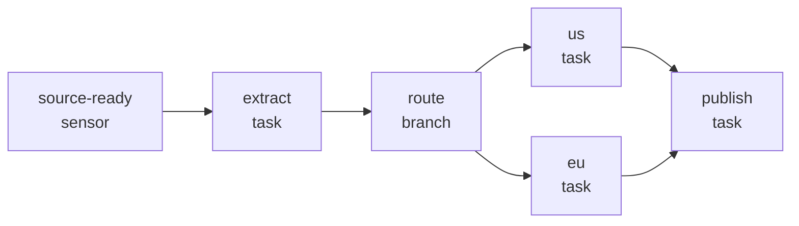

<!-- Logo lives at ./logo.png beside this README. -->
<p align="center">
  
</p>

<h1 align="center">Badag</h1>

<p align="center">
  <strong>Strongly-typed DAGs.</strong><br />
  Author with a dialect, compile to a versioned spec, run it.
</p>

<p align="center">
  
  
  
</p>

Badag is a TypeScript SDK for task graphs. Dialects supply the authoring vocabulary — the first is Airflow-inspired — and compile to one frozen JSON spec plus a registry of implementations, which you hand to a runtime. Execution state belongs to a separate runtime.

> **The graph is data. Code is keyed by node. Dialects compile to the same graph.**

## Install

```sh
bun add @badag/sdk
```

ESM-only, ships declaration files, and bundles the graph, DAG, Airflow, and runtime packages. One install covers authoring through in-memory execution.

## A graph in 30 seconds

Using the Airflow dialect, a daily pricing job: wait for the vendor drop, extract prices, route by region, publish after the selected region finishes.



```ts
import { branch, check, createDAG, run, sensor, task } from "@badag/sdk";

const sourceReady = sensor("source-ready", {
    predicate: () => true, // the vendor drop arrived
    pokeIntervalMs: 60_000,
});
const extract = task("extract", {
    run: async () => [
        { region: "us", price: 120 },
        { region: "eu", price: 110 },
    ],
});
const route = branch("route", {
    branches: ["us", "eu"] as const,
    choose: () => (process.env.REGION === "eu" ? "eu" : "us"),
});
const us = task("us", { run: () => "priced US" });
const eu = task("eu", { run: () => "priced EU" });
const publish = task("publish", {
    triggerRule: "none_failed_min_one_success",
    run: () => "published",
});

const pricing = createDAG("daily-pricing")
    .parse`${sourceReady} >> ${extract} >> ${route}`
    .parse`${route} >> ${[us, eu]}`.parse`${[us, eu]} >> ${publish}`;

check(pricing.spec()); // [] — structural and dialect findings

const { spec, implementations } = pricing.build();
const result = await run({ spec, implementations });

result.outcomes.get("publish")?.status; // "succeeded"
```

`build()` splits the two channels:

- The **spec** is pure data — node keys, open types, JSON config, labeled edges, and a content revision. It is frozen, callback-free, and serializable.
- The **implementations** are build-local code keyed by node key. They never enter the spec.

The node key is the only join. A spec loaded from storage and a DAG built in memory cross the same seams: `check(spec)`, `orderSpec(spec)`, `run({ spec, implementations })`.

## Dialects

`@badag/airflow` is the first dialect, and the only one that ships today. It supplies the presets, `>>` / `<<` notation, Airflow key convention, and dialect findings documented below.

The graph and task layers contain no Airflow vocabulary: `@badag/graph` owns the spec and structural checks, and `@badag/dag` keys implementations by node. `@badag/runtime` switches on `config.role` rather than node type; its activation-policy names borrow Airflow's trigger-rule vocabulary, but the contract is shared. A future dialect — not yet built — can add its own presets, notation, and checks, then compile to the same `GraphSpec` v1. As long as it writes the runtime's `role`, `triggerRule`, and `retries` config keys, it reuses the same implementations and runtime.

## Wiring

```ts
dag.parse`${a} >> ${b} >> ${c}`; // a -> b -> c
dag.parse`${a} >> ${b} << ${c}`; // a -> b, c -> b
dag.parse`${route} >> ${[us, eu]}`; // labeled edges us and eu
dag.parse`${route} >> ${labeled("us", processUs)}`; // explicit label
```

An edge **out of a router** defaults to the target's key as its route label. Every other edge is unlabeled. `labeled(label, node)` overrides the default, so a route name never dictates a node's key. Wiring is transactional: a rejected operand, label, edge, or duplicate leaves the DAG unchanged.

## Presets

Every preset accepts `description`, `config`, and `triggerRule`. `task` also accepts `input` and `output`; `branch`, `sensor`, `shortCircuit`, and `trigger` accept `input`; `delay` declares neither schema.

| Preset | Role | Config | Notes |
| --- | --- | --- | --- |
| `task` | compute | metadata | the work |
| `branch` | router | `branches` | selects route labels |
| `sensor` | waiter | `pokeIntervalMs` | polls a predicate |
| `delay` | waiter | `durationMs` | code supplied by the runtime |
| `shortCircuit` | router | `branches: ["run","skip"]` | two fixed labels |
| `trigger` | compute | `dagId`, `waitForCompletion` | may suspend on the target run |

Roles are config, not new node types: `role` is `compute`, `router`, or `waiter`, and the runtime switches on it. A custom type becomes a router by setting `config.role`.

## Routing and activation

A router returns the labels it activates, and may name a node key for a target that is not an immediate child. Route activity survives a skipped upstream, so a non-adjacent target can run when its policy tolerates skipped intermediates.

Activation policies: `all_success` (default), `all_done`, `one_success`, `one_failed`, `none_failed`, `none_failed_min_one_success`, `all_skipped`. A node with no route-active incoming edge is skipped — terminal, never a failure.

Retries are per node: `config.retries` is a non-negative integer, default `0`. A failed attempt retries in place, and every attempt emits its own events.

## Findings

`check(spec)` returns structural findings followed by dialect findings, each `{ code, subjects, message }`:

- Structural: `duplicate-node`, `unknown-node`, `self-edge`, `cycle`.
- Dialect: `invalid-dag-id`, `invalid-node-key`, `duplicate-declared-branch`, `invalid-declared-branch`, `unrouted-branch`, `undeclared-branch-target`, `self-trigger`.

## Packages

| Package | Responsibility |
| --- | --- |
| `@badag/graph` | dialect-agnostic nodes, labeled edges, order, cycles, structural findings, the spec |
| `@badag/dag` | node = key + type + config, implementation registry, `build()` |
| `@badag/airflow` | first dialect: six presets, trigger-rule names, `>>` / `<<`, key convention, dialect findings |
| `@badag/runtime` | in-memory execution, route propagation, activation policies, retries |
| `@badag/db-schema` | Drizzle schemas: revision-scoped graphs and runs (`main-db`), task executions (`orchestrator-db`) |
| `@badag/sdk` | the published entry point for the Airflow dialect; bundles `@badag/graph`, `@badag/dag`, `@badag/airflow`, and `@badag/runtime` |

## Status

Pre-release (`0.0.0`). The SDK is the only published package; the others are source-only workspace packages. Airflow is the only dialect today; `@badag/graph` and `@badag/dag` carry no Airflow vocabulary, and `@badag/runtime` depends on only the `role`, `triggerRule`, and `retries` config contract, so future dialects can compile to the same spec. `@badag/db-schema` stores revision-scoped graphs: immutable revisions own the serialized spec, node rows, and labeled edges; runs reference a revision; task executions live in a second database. The SDK runtime is in-memory and writes none of it.
