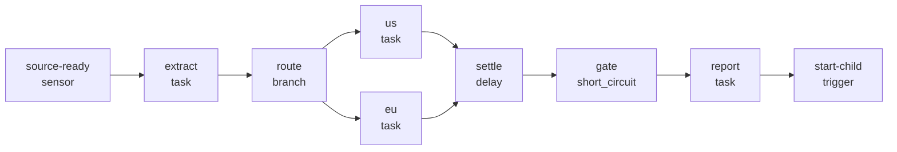

# @badag/core

An Airflow-inspired DAG builder for TypeScript. Declare tasks, wire dependencies, validate the graph, and read back a topological order. Execution state belongs to your runtime.

- Source-only internal package: `exports` points at `src/index.ts`, so there is no build step or published artifact.
- Every edge inserted through the public methods is validated, so a `DAG` cannot become cyclic or cross DAG boundaries.
- Task ids stay literal types; graph links are `ReadonlySet`, so they cannot be mutated by accident.

## Source layout

| Path | Responsibility |
| --- | --- |
| `src/dag/` | The `DAG` aggregate, registered task handles, parse-time type checks, wiring, graph audit, and serialization |
| `src/task/` | Task kinds and their public types, one factory per kind, and the definition helpers shared by those factories |

Within `dag/`, `typing.ts` holds only compile-time bookkeeping, `audit.ts` holds the read-only violation rules, and the aggregate, handles, wiring, and serialization modules sit at the folder root. Within `task/`, one module per kind carries that kind's public types and factory; `base.ts` holds the shared types, while `id.ts`, `definition.ts`, and `identity.ts` hold id validation, definition assembly, and duplicate-id behavior.

## Import

Workspace consumers import the TypeScript source directly:

```ts
import {
    branch,
    createDAG,
    crossDownstream,
    delay,
    sensor,
    shortCircuit,
    task,
    trigger,
    TASK_KIND_ENUM,
    TRIGGER_RULE_ENUM,
} from "@badag/core";
```

Types come from the same entry point:

```ts
import type {
    AnyTaskDefinition,
    BranchTaskDefinition,
    CreateTask,
    DAGJson,
    DAGId,
    DAGIdRegistry,
    DAGTask,
    DelayTaskDefinition,
    SensorTaskDefinition,
    ShortCircuitTaskDefinition,
    TaskConfig,
    TaskContext,
    TaskFn,
    TaskJson,
    TaskKind,
    TaskLike,
    TaskOrTasks,
    TaskParamInput,
    TaskParamOutput,
    RegisteredTaskDefinition,
    TriggerRule,
    TriggerTaskDefinition,
} from "@badag/core";
// or inline, mixing values and types:
import { createDAG, type DAGTask, sensor, task } from "@badag/core";
```

## Quick start

The example below uses all six task kinds: a `sensor` waits for the source to exist, a `task` extracts, a `branch` picks a region, a `delay` settles, a `shortCircuit` can skip the report, and a `trigger` starts another DAG. It builds this graph:



```ts
import {
    branch,
    createDAG,
    delay,
    sensor,
    shortCircuit,
    task,
    trigger,
} from "@badag/core";

const sourceReady = sensor("source-ready", {
    predicate: async () => bucketHasData(),
    pokeIntervalMs: 60_000,
});

const extract = task("extract", {
    fn: (ctx) => ({ source: ctx.id, rows: 42 }),
});

const route = branch("route", {
    branches: ["us", "eu"], // the only names routing may follow
    choose: (ctx) => (ctx.id === "route" ? "us" : "eu"),
});

const us = task("us", { fn: () => "us: priced" });
const eu = task("eu", { fn: () => "eu: priced" });

const settle = delay("settle", { durationMs: 300_000 });

const gate = shortCircuit("gate", {
    condition: async () => (await hasRows()) === false,
});

const report = task("report", { fn: () => "report: sent" });

const startChild = trigger("start-child", {
    dagId: "publish",
    waitForCompletion: true,
});

const dag = createDAG("pricing").parse`${sourceReady} >> ${extract} >> ${route}`
    .parse`${route} >> ${[us, eu]}` // a branch can route to every declared name
    .parse`${[us, eu]} >> ${settle} >> ${gate} >> ${report} >> ${startChild}`;
```

`topologicalSort()` returns `["source-ready", "extract", "route", "us", "eu", "settle", "gate", "report", "start-child"]`. Each registration keeps its kind, so a scheduler can tell a poll from a wait from a hand-off:

```ts
for (const registered of dag.topologicalSort()) {
    console.log(registered.id, registered.definition.kind);
}

// source-ready  sensor
// extract       task
// route         branch
// us            task
// eu            task
// settle        delay
// gate          short_circuit
// report        task
// start-child   trigger
```

The SDK stores the graph and runs nothing; [Running tasks](#running-tasks) shows a scheduler dispatching on those kinds. Declaration details per factory are in [Task kinds](#task-kinds).

## Declaring tasks

Regular task definitions come from `task()`; every task factory produces a definition that `parse()` registers in the DAG as it wires the graph:

```ts
import { createDAG, task } from "@badag/core";

const extract = task("extract", {
    fn: () => fetch("https://example.com/data").then((res) => res.text()),
    description: "Fetch the source dataset",
    config: { timeout_ms: 30_000 },
});
const load = task("load", { fn: () => "stored" });

const dag = createDAG("etl").parse`${extract} >> ${load}`;
```

Every task callback receives its task context as the first argument. The context contains the task's literal id:

```ts
import { createDAG, task, TASK_KIND_ENUM } from "@badag/core";

const report = task("report", {
    fn: (ctx) => ctx.id.toUpperCase(),
});

const dag = createDAG("etl").parse`${report}`;
const reportTask = dag.getTask("report");

if (reportTask?.definition.kind === TASK_KIND_ENUM.Task) {
    await reportTask.definition.fn({
        id: reportTask.id,
        payload: undefined,
    }); // "REPORT"
}
```

A task definition carries its `id`, and registration stores exactly that id on the `DAGTask`.

- `parse()` registers every definition it encounters before linking. A definition whose id is already registered is reused when it describes the same behavior, so repeated calls are idempotent; the first registration's metadata is kept and a duplicate's metadata is discarded. Reusing an id with different behavior is rejected at compile time when the returned DAG is kept; cycles are rejected when the call runs.
- Every batch is transactional: an id reused with different behavior, a self-edge, a cross-DAG edge, or a cycle leaves both the task registry and the edges unchanged.
- A single operand registers without adding edges, which is how isolated tasks are declared: `` dag.parse`${[extract, load]}` ``.
- `addDependency()`, `addDependencies()`, `setUpstream()`, `setDownstream()`, and `dependsOn()` also register definitions on first use.
- The first argument is the task id. It is trimmed, must be unique inside the DAG, and is preserved as a literal type: `"  extract  "` becomes `"extract"`. Ids follow Airflow's `task_id` convention: letters, numbers, `_`, `.`, and `-`, at most 250 characters; internal whitespace and other punctuation are rejected.
- A regular task's `fn`, a sensor's `predicate`, a branch's `choose`, and a short-circuit's `condition` receive `{ id }` as their first argument, with `id` narrowed to the declaration's literal id.
- `triggerRule` defaults to `all_success`; the SDK stores it for the scheduler and does not evaluate it.
- `description` is an optional human-readable string stored verbatim on the definition and registered task.
- `config` is stored verbatim on the registered task; the SDK does not interpret it.

### Trigger rules

`triggerRule` is available on the definition and on the registered task. It records when the scheduler may run the task, but the SDK does not evaluate it yet. The exported `TRIGGER_RULE_ENUM` provides the values as an enum-like object.

| Rule | Meaning |
| --- | --- |
| `all_success` | All upstream tasks succeed. The default. |
| `all_done` | All upstream tasks reach a terminal state, regardless of outcome. |
| `one_success` | At least one upstream task succeeds; the task may run before the others finish. |
| `one_failed` | At least one upstream task fails; the task may run before the others finish. |
| `none_failed` | All upstream tasks finish with no failures; skipped upstreams are allowed. |
| `none_failed_min_one_success` | All upstream tasks finish, none fail, and at least one succeeds. |
| `all_skipped` | All upstream tasks are skipped. |

```ts
import { task, TRIGGER_RULE_ENUM } from "@badag/core";

const report = task("report", {
    fn: () => "done",
    triggerRule: TRIGGER_RULE_ENUM.AllDone,
});

report.triggerRule; // "all_done"
```

### Reusing a definition

`task()` builds a regular task definition outside any DAG. Every factory trims and validates the id there, and the definition carries that id. Registering the definition in any DAG stores the same id, so one definition can be reused across DAGs without recomputing anything.

Within one DAG, a task is identified only by its id. Registering the same id again reuses the existing task when the behavior matches; metadata differences are ignored and the first registration wins. Reusing an id with different behavior throws.

```ts
import { task } from "@badag/core";

const nightly = task("cleanup", { fn: () => removeStaleRows() });

const etl = createDAG("etl").parse`${nightly}`;
const audit = createDAG("audit").parse`${nightly}`;
```

#### Duplicate ids must describe the same behavior

A callable kind compares callback references. Reusing the same definition or callback instance is a duplicate; a different function reference under the same id is a conflict, even when the captured values happen to be equal, because the SDK cannot inspect closures. Declarative kinds compare the fields that determine their behavior, such as `durationMs` or a trigger's target and wait flag.

```ts
import { createDAG, task } from "@badag/core";

const syncTable = (table: string) => () => `syncing ${table}`;
const syncCustomers = syncTable("customers");

const dag = createDAG("warehouse").parse`${task("sync", { fn: syncCustomers })}`
    .parse`${task("sync", { fn: syncCustomers })}`;

dag.tasks.size; // 1 — the same callback instance is a duplicate definition
```

A different callback instance under the same id is rejected instead of silently dropped, because the SDK cannot tell whether the captured values differ:

```ts
import { createDAG, task } from "@badag/core";

const syncTable = (table: string) => () => `syncing ${table}`;

const dag = createDAG("warehouse").parse`${task("sync", {
    fn: syncTable("customers"),
})}`;

dag.parse`${task("sync", { fn: syncTable("orders") })}`;
// throws: Task "sync" already exists in DAG "warehouse" with different
// behavior; reuse the same definition or choose a different task id
```

Bound functions behave the same way: two separate `bind()` results are different callback instances, so they conflict under one id. Reuse one bound reference when both registrations are meant to be the same task.

An id is unique inside a DAG, so a capture-only pair needs distinct ids:

```ts
import { createDAG, task } from "@badag/core";

const syncTable = (table: string) => () => `syncing ${table}`;

const dag = createDAG("warehouse")
    .parse`${task("sync-customers", { fn: syncTable("customers") })}`
    .parse`${task("sync-orders", { fn: syncTable("orders") })}`;

dag.tasks.size; // 2 — distinct ids, distinct tasks
```

Reuse the same definition or callback instance when the registrations are intentionally the same task; use distinct ids when the captured values must both run. See [ADR 0009](../../docs/adr/0009-task-id-is-declared.md) for why identity is the declared id.

## Task kinds

Every factory returns a task definition with a common shape: `kind`, `id`, and optional `description`, `config`, and `triggerRule`. Behavior fields are task-specific: a regular task has `fn`, a sensor has `predicate`, a delay has `durationMs`, a branch has `choose`, a short-circuit has `condition`, and a trigger has `dagId`/`waitForCompletion`. The registered `DAGTask` exposes `kind` and the original `definition`; there is no universal task callback.

```ts
import {
    branch,
    delay,
    sensor,
    shortCircuit,
    task,
    trigger,
    TASK_KIND_ENUM,
    TRIGGER_RULE_ENUM,
} from "@badag/core";

const extract = task("extract", { fn: () => "raw" });

const ready = sensor("ready", {
    predicate: async () => bucketHasData(),
    pokeIntervalMs: 5000,
});

const settle = delay("settle", { durationMs: 30_000 });

const route = branch("route", {
    choose: (ctx) => (ctx.id === "route" ? ["us", "eu"] : "us"),
});

const gate = shortCircuit("gate", {
    condition: async () => (await hasData()) === false,
});

const start = trigger("start-child", {
    dagId: "child",
    waitForCompletion: true,
});
```

Use `TASK_KIND_ENUM` wherever a kind is compared or stored. It exposes `Task`, `Sensor`, `Delay`, `Branch`, `ShortCircuit`, and `Trigger`.

| Factory | `kind` | Kind-specific fields | Produced by default |
| --- | --- | --- | --- |
| `task(id, { fn })` | `TASK_KIND_ENUM.Task` | `fn` | `unknown` |
| `sensor(id, { predicate, pokeIntervalMs? })` | `TASK_KIND_ENUM.Sensor` | `predicate`, optional `pokeIntervalMs` | `boolean` |
| `delay(id, { durationMs })` | `TASK_KIND_ENUM.Delay` | `durationMs` | none |
| `branch(id, { branches?, choose })` | `TASK_KIND_ENUM.Branch` | `branches`, `choose` | the chosen branch names; declared `branches` constrain the next wiring step |
| `shortCircuit(id, { condition })` | `TASK_KIND_ENUM.ShortCircuit` | `condition` | `boolean` |
| `trigger(id, { dagId, waitForCompletion? })` | `TASK_KIND_ENUM.Trigger` | `dagId`, `waitForCompletion` | none |

All kinds accept the common metadata as well:

```ts
const ready = sensor("ready", {
    predicate: () => true,
    description: "Wait for the source bucket",
    config: { timeout_ms: 60_000 },
    triggerRule: TRIGGER_RULE_ENUM.AllDone,
});
```

Factories validate kind-specific values immediately: a sensor interval must be positive, a delay duration must be non-negative, and a trigger's target DAG id must not be blank.

### Task inputs and outputs

Every task kind accepts optional `input` and `output` Standard Schemas. Any library implementing [Standard Schema](https://standardschema.dev) works directly — Valibot, Zod, and ArkType are all verified in the test suite.

`input` types `ctx.payload`. `output` constrains what the callback may return.

```ts
import { type } from "arktype";
import * as v from "valibot";
import { z } from "zod";

const syncOrders = task("sync-orders", {
    input: v.object({ warehouseId: v.string(), rows: v.number() }),
    output: v.pipe(v.number(), v.minValue(0)),
    fn: (ctx) => ctx.payload.rows, // `rows` is a number
});

// Same task, other libraries: the schema's inferred type drives `ctx.payload`.
task("zod-input", {
    input: z.object({ rows: z.number() }),
    fn: (ctx) => ctx.payload.rows * 2,
});
task("ark-input", {
    input: type({ rows: "number>0" }),
    fn: (ctx) => ctx.payload.rows * 2,
});
```

Without an `input` schema, `ctx.payload` is `undefined`. Without an `output` schema, the result is `unknown`.

Schemas are declared, not applied: the SDK stores them and does not validate `ctx.payload` or the returned value. A scheduler that wants validated values calls `schema["~standard"].validate(...)` itself. Because the protocol is uniform, the same call site works for every library — the result carries `value` on success and `issues` on failure, and may be a promise when the schema validates asynchronously.

Kinds with a fixed result carry a default `output` schema describing it, so the produced value is known without writing one. The default is a type-level description only: no schema object is created, so `"output" in definition` stays `false` and `toJSON()` is unaffected.

| Kind                       | Default `output`                                |
| -------------------------- | ----------------------------------------------- |
| `sensor`                   | `boolean` — whether the predicate became true   |
| `shortCircuit`             | `boolean` — whether downstream tasks should run |
| `branch`                   | the `branches` entries, chosen or not           |
| `task`, `delay`, `trigger` | none                                            |

Read a produced value back with `TaskProducedOf<typeof definition.output>`. It accepts the optional property directly, so no `NonNullable` is needed:

```ts
const ready = sensor("ready", { predicate: () => true });

type ReadyResult = TaskProducedOf<typeof ready.output>; // boolean
```

`branch` infers its names from the `branches` tuple, which also constrains what `choose` may return:

```ts
const route = branch("route", {
    branches: ["us", "eu"], // inferred as the literal tuple
    choose: () => "us", // only "us" | "eu" are accepted
});
```

Schemas are metadata: declaring one does not change the task ID, and schemas are never serialized by `toJSON()`.

The SDK stores and serializes these task kinds, but it does not execute, poll, wait, or prune the graph. `pokeIntervalMs` and `durationMs` are declarative fields for a scheduler. A scheduler should use `DAGTask.kind`, `DAGTask.definition`, and the kind-specific callback or fields — for example, to poll a sensor at its interval, honor a delay, run only the branches named by a branch task, skip downstream work after a false short-circuit condition, or start the DAG named by a trigger definition.

```ts
const dag = createDAG("kinds")
    .parse`${extract} >> ${ready} >> ${settle} >> ${route} >> ${gate} >> ${start}`;

for (const registered of dag.topologicalSort()) {
    console.log(registered.kind);
}

dag.toJSON().tasks; // includes kind and serializable kind-specific fields
```

### Task kind examples

Each factory keeps its kind-specific fields on the definition:

#### Regular task

```ts
const extract = task("extract", {
    fn: async (ctx) => {
        const response = await fetch("https://example.com/data");

        return { id: ctx.id, body: await response.text() };
    },
    description: "Fetch the source dataset",
    config: { retries: 3 },
});
```

#### Sensor

```ts
const fileReady = sensor("file-ready", {
    predicate: async (ctx) => {
        const response = await fetch(`https://example.com/status/${ctx.id}`);

        return response.ok;
    },
    pokeIntervalMs: 2000,
});

fileReady.kind; // TASK_KIND_ENUM.Sensor
fileReady.pokeIntervalMs; // 2000
```

The interval is optional. Without it, a scheduler chooses its own polling cadence:

```ts
const checkOnce = sensor("check-once", {
    predicate: () => true,
});
```

A scheduler calls `fileReady.predicate(ctx)` and repeats the call according to `pokeIntervalMs`. The SDK itself never evaluates the predicate.

#### Delay

```ts
const cooldown = delay("cooldown", { durationMs: 60_000 });

cooldown.kind; // TASK_KIND_ENUM.Delay
cooldown.durationMs; // 60_000
```

A zero duration is valid:

```ts
const immediate = delay("immediate", { durationMs: 0 });
```

A scheduler reads `cooldown.durationMs` and waits. The definition itself has no callback.

#### Branch

A branch can choose one branch:

```ts
const retryPath = branch("retry-path", {
    choose: () => "retry" as const,
});

await retryPath.choose({
    id: "retry-path",
    payload: undefined,
}); // "retry"
```

or several branches:

```ts
const byRegion = branch("by-region", {
    choose: (ctx) => (ctx.id === "by-region" ? (["us", "eu"] as const) : "us"),
});

await byRegion.choose({
    id: "by-region",
    payload: undefined,
}); // ["us", "eu"]
```

Declare `branches` as well to make the names a wiring contract:

```ts
const route = branch("route", {
    branches: ["us", "eu"],
    choose: (ctx) => (ctx.id === "route" ? ["us", "eu"] : "us"),
});

const dag = createDAG("regions").parse`${route} >> ${[
    task("us", { fn: () => "us" }),
    task("eu", { fn: () => "eu" }),
]}`;
```

With `branches` declared, the wiring step that routes the branch must name exactly those branches, in one step: routing to an undeclared task, or declaring a branch that step does not route to, is rejected when the wiring call runs. That step need not come directly after the branch task — registering the branch alone and wiring it later is fine, and the branch simply reports itself unrouted until then. A branch without `branches` stays unchecked, and only the branch's own downstream step is constrained — what those tasks require next is not.

A scheduler uses the returned name(s) to decide which downstream tasks to run.

#### Short-circuit

```ts
const skipIfEmpty = shortCircuit("skip-if-empty", {
    condition: async () => (await countRows()) === 0,
});

await skipIfEmpty.condition({
    id: "skip-if-empty",
    payload: undefined,
}); // true or false
```

When the condition tells the scheduler to stop, downstream tasks can be skipped without running them.

#### Trigger

Trigger another DAG without waiting:

```ts
const backup = trigger("backup", {
    dagId: "backup-dag",
});

backup.dagId; // "backup-dag"
backup.waitForCompletion; // false
```

Trigger and wait for completion:

```ts
const waitForBackup = trigger("wait-for-backup", {
    dagId: "backup-dag",
    waitForCompletion: true,
});

waitForBackup.waitForCompletion; // true
```

A scheduler reads these fields, starts the target DAG, and waits when requested.

##### Typing the target DAG id

`dagId` accepts any non-blank string by default. Augment `DAGIdRegistry` to narrow it to the DAG ids your project declares, so a misspelled target fails to typecheck:

```ts
// dag-names.d.ts
import type {} from "@badag/core";

declare module "@badag/core" {
    interface DAGIdRegistry {
        // keys are DAG ids; the values are ignored
        "backup-dag": true;
        "restore-dag": true;
    }
}
```

```ts
trigger("backup", { dagId: "backup-dag" }); // ok
trigger("backup", { dagId: "backup_dag" }); // type error
```

The registry is type-only: `trigger()` still stores any non-blank id at runtime, the `DAGId` export widens back to `string` while the interface has no keys, and augmenting `@badag/sdk` narrows the same type.

#### Inspecting a registered kind

```ts
const registered = dag.getTask("file-ready");

if (registered?.definition.kind === TASK_KIND_ENUM.Sensor) {
    registered.definition.kind; // TASK_KIND_ENUM.Sensor
    registered.definition.pokeIntervalMs; // number | undefined
}
```

### Lookup

```ts
dag.getTask("extract"); // DAGTask<"extract"> | undefined
dag.tasks; // ReadonlyMap<string, DAGTask>, keyed by id
```

## Wiring dependencies

An edge points from an upstream task to a downstream task. With `a` and `b` as registered `DAGTask` handles, all of these add `a -> b`:

```ts
a.setDownstream(b);
b.setUpstream(a);
b.dependsOn(a); // alias for setUpstream()
dag.addDependency(a, b);
dag.addDependencies([a, b], [c, d]); // a -> c, a -> d, b -> c, b -> d
```

Handles come from `dag.getTask()` or from `topologicalSort()`. Definitions work anywhere a handle does; edge methods register them on first use.

Wiring sets link every member of one set to every member of the next. `parse()` registers definitions before linking and accepts wiring sets as operands; `crossDownstream()` takes handles only:

```ts
dag.parse`${a} >> ${[b, c]} >> ${d}`; // a -> b, a -> c, b -> d, c -> d
crossDownstream([a, b], [c, d]); // a -> c, a -> d, b -> c, b -> d
```

`parse()` returns the DAG, so calls compose. Each wiring set is normalized once, definitions are validated and registered before any edge is added, and already-linked edges are skipped, so repeated calls are idempotent. Every batch is all-or-nothing: if any edge is rejected, the call adds neither tasks nor edges. `crossDownstream()` is the free-function form for full bipartite linking and delegates to `addDependencies()`.

### Wiring patterns

Pass each task or wiring set as a separate operand. Multiple plain tasks form a linear chain in one expression:

```ts
const extract = task("extract", { fn: () => "raw" });
const transform = task("transform", { fn: () => "clean" });
const load = task("load", { fn: () => "stored" });

const dag = createDAG("etl").parse`${extract} >> ${transform} >> ${load}`;
// extract -> transform -> load
```

An array between plain tasks fans out to the array and fans in from it:

```ts
const extract = task("extract", { fn: () => "raw" });
const cleanA = task("cleanA", { fn: () => "cleanA" });
const cleanB = task("cleanB", { fn: () => "cleanB" });
const join = task("join", { fn: () => "joined" });
const validate = task("validate", { fn: () => "valid" });
const publish = task("publish", { fn: () => "published" });

const dag = createDAG("etl")
    .parse`${extract} >> ${[cleanA, cleanB]} >> ${join} >> ${validate} >> ${publish}`;
// extract -> cleanA, extract -> cleanB
// cleanA -> join, cleanB -> join
// join -> validate -> publish
```

A handle repeated inside one wiring set adds only one edge. Empty operands are rejected: `parse` cannot express an empty wiring set, so an empty step must be omitted from the expression rather than written between two operands.

Separate `parse()` calls are independent: each call adds only the edges inside that call, and no edge is added between calls.

```ts
createDAG("etl").parse`${a} >> ${b}`.parse`${c} >> ${d}`;
// a -> b and c -> d; no b -> c edge
```

To build one continuous four-task chain, pass all tasks to a single expression or share boundary tasks between calls:

```ts
createDAG("etl").parse`${a} >> ${b} >> ${c} >> ${d}`;
createDAG("etl").parse`${a} >> ${b}`.parse`${b} >> ${c}`.parse`${c} >> ${d}`;
// both: a -> b -> c -> d
```

Wiring set boundaries do not weaken validation: self edges, cycles across wiring sets, invalid duplicate definitions, and handles from another DAG are rejected.

### Bitshift notation

`dag.parse` wires tasks with Airflow's `>>`/`<<` notation, written as a tagged template. `>>` means "then" and `<<` means "before"; operators evaluate left to right, and each result becomes the left-hand side of the next:

```ts
const a = task("a", { fn: () => "a" });
const b = task("b", { fn: () => "b" });
const c = task("c", { fn: () => "c" });

const dag = createDAG("etl").parse`${a} >> ${b} >> ${c}`; // a -> b -> c
```

A `DAGTask` handle or a wiring set is a valid operand, so `>>` and `<<` compose exactly like Airflow's `set_downstream`/`set_upstream`:

```ts
createDAG("etl").parse`${a} >> ${b} << ${c}`; // a -> b, c -> b
createDAG("etl").parse`${[a, c]} >> ${b}`; // the same graph
createDAG("etl").parse`${a} >> ${[b, c]} >> ${d}`; // fan out, then fan in
```

An expression with one operand registers the task without wiring it:

```ts
createDAG("etl").parse`${extract}`; // registers "extract", adds no edge
```

One expression per call. A newline inside the template is rejected rather than treated as a statement separator, so a second expression is a second call:

```ts
createDAG("etl").parse`${extract} >> ${clean}`.parse`${clean} >> ${load}`;
```

`parse()` accepts the same operands as every other wiring path: a handle from this DAG, or a definition that is registered on first use. It is transactional — a rejected task, edge, or notation is rolled back, leaving neither tasks nor edges behind. Already-linked edges are skipped, so repeating an expression is idempotent.

Text outside the operands is validated: a leading or trailing fragment, two adjacent operands, an empty operand list, a nested list, and an empty list are all errors. Whitespace around an operator is allowed, so `${a}>>${b}` and `${a}   >>   ${b}` are both accepted.

`parse()` registers its operands in the DAG's type: the returned DAG carries every parsed definition's id and signature, so a later `parse()` call that reuses an id with a different signature is rejected at compile time.

```ts
const extract = task("extract", { fn: () => "raw" });
const dag = createDAG("etl").parse`${extract}`;

dag.parse`${task("extract", { fn: () => 1 })}`; // error: task "extract" already exists in DAG "etl"
```

Edges are not part of that state. TypeScript infers the interpolated operands as tasks — a string, a number, or a nested list fails to typecheck — but it does not infer the literal `>>`/`<<` segments, so the DAG cannot see the operator sequence at compile time. Cycles, self edges, cross-DAG handles, and branch routing are therefore checked when `parse()` runs, not when the file typechecks. See [ADR 0006](../../docs/adr/0006-bitshift-notation-is-runtime-validated.md).

### Compile-time parse checks

`DAG` carries the definitions and declared branch sets added by `parse()` in its type, so duplicate definitions and branch declarations fail to typecheck:

```ts
const a = task("a", { fn: () => "a" });
const b = task("b", { fn: () => "b" });

const dag = createDAG("etl").parse`${a} >> ${b}`;

const duplicate = task("a", { fn: () => 1 });
dag.parse`${duplicate}`; // error: task "a" already exists in DAG "etl"
```

- The type-level duplicate-definition check compares task ids and inferred function signatures. Re-passing the same definition is allowed because runtime registration is idempotent; a same-id definition with a different function type is rejected.
- A branch task's declared set is recorded in the DAG type, so reusing the branch id with a different declared set is rejected at compile time. Whether a wiring step routes exactly to those names is a runtime check: TypeScript cannot see the operator direction.
- Static checks run for `parse()` calls with up to 40 operands. Larger calls compile but are runtime-checked only, and their definitions and branch state are not added to the DAG type state.
- The checks follow the value returned by `parse()`. If the result is discarded, later calls are runtime-checked only. `addDependency()`, `addDependencies()`, `setUpstream()`, `setDownstream()`, and `crossDownstream()` are likewise runtime-checked.
- Generic helpers that widen task ids or DAG state to `string` skip the static checks and rely on runtime validation.
- Handles from `getTask()` and `topologicalSort()` carry the erased `AnyTaskDefinition`, so they add edges but no signatures; type-level duplicate detection compares regular `fn` signatures, while runtime remains authoritative for handle-only wiring.
- Regular definitions with the same id and inferred `fn` type but different `fn` behavior cannot be distinguished statically; non-regular definitions are opaque to type-level signature checks. Runtime still rejects conflicts.
- Edges are never statically checked: `parse()` cannot read the operators, so cycles and self edges are runtime findings.

### Validating a graph

`validate()` returns every problem in the graph as a list, without throwing. The DAG id is stored verbatim, so an id outside Airflow's convention surfaces here; the wiring methods reject malformed graphs as they run. The method is also for graphs that reach a checkpoint later — a snapshot, a graph restored from storage, a half-built DAG before execution — and for the states wiring cannot see at the time of a call.

```ts
const route = branch("route", { branches: ["us", "eu"], choose: () => "us" });

const dag = createDAG("daily").parse`${route}`;

dag.validate();
// [
//   { code: "unrouted-branch", subjects: ["route", "us"], message: 'Branch "route" must route to declared branch "us"' },
//   { code: "unrouted-branch", subjects: ["route", "eu"], message: 'Branch "route" must route to declared branch "eu"' },
// ]
```

A branch task declares the branches a scheduler may follow, so registering one alone leaves it temporarily unrouted; pairing it with the tasks that carry those names clears the finding. Checking `validate()` before execution catches exactly that.

Every finding has a `code`, the `subjects` involved, and a `message` describing the problem. `subjects` holds the offending value for an invalid DAG id or task id, both endpoints for an edge, the traversal path (closing task repeated) for a cycle, and `[branch, declaredName]` for a branch or trigger finding. Branch and trigger findings name a declared branch or a DAG, not a task, so the field is called `subjects` rather than `tasks`. Findings are ordered identifiers, edges, cycles, branch routing, then trigger findings.

| Code | Meaning |
| --- | --- |
| `invalid-dag-id` | The DAG's id does not follow Airflow's `dag_id` convention |
| `invalid-task-id` | A registered task's id does not follow Airflow's `task_id` convention |
| `cycle` | An edge joins a task back to one of its own ancestors |
| `self-edge` | A task lists itself as an upstream or downstream task |
| `foreign-edge` | An edge endpoint is not registered in this DAG |
| `inconsistent-edge` | One side of an edge records a dependency the other side does not |
| `unrouted-branch` | A branch task declares a branch name it never routes to |
| `undeclared-branch-target` | A branch task routes to a task it never declared |
| `duplicate-declared-branch` | A branch task declares the same branch name more than once |
| `invalid-declared-branch` | A branch task declares a name that cannot be a task id |
| `self-trigger` | A trigger task starts the DAG that contains it |

`duplicate-declared-branch` and `invalid-declared-branch` are reachable through the factories: `branches: ["us", "us"]` and a declared name like `""` or `"united states"` are both accepted by `branch()`, and neither can be satisfied by wiring. A name that is invalid is reported as `invalid-declared-branch` rather than additionally as `unrouted-branch`, because no task could ever carry it.

`invalid-dag-id` is reachable through the public API, because `createDAG()` and `new DAG()` store the id verbatim; `validate()` is where the convention is checked. `invalid-task-id` is not reachable that way, because registration rejects an invalid task id first; it exists for graphs restored or assembled outside the public methods.

An empty array means the DAG id and every task id follow Airflow's `validate_key` convention, the graph is acyclic, internally consistent, and every branch routes exactly to its declared branches.

Reporting rules, each pinned by a test:

- A self edge yields `self-edge` only, never an additional `cycle`, whether it is recorded on one side or both.
- An identifier finding is one violation for the offending value, reported before every structural finding.
- Each distinct cycle yields one finding, named by the path that closes it with the first task repeated. Cycles that share a task are separate findings.
- An edge yields at most one finding: the downstream side and the upstream side report disjoint conditions on the same edge.
- A mutual cross-DAG edge yields one finding per direction, so the two `subjects` lists differ.
- Foreign targets are reported but not traversed; their own edges belong to the DAG that owns them, so one graph's report never includes another's cycles.
- A branch finding is per branch name, so a repeated declared name yields one finding, and an invalid declared name is reported once as `invalid-declared-branch`.
- A trigger comparison trims both ids, so `dagId: " daily "` inside DAG `"daily"` is still a self-trigger. Ids that differ by case are distinct DAGs.
- `validate()` only reads the graph, so calling it never changes state.

Edge methods accept either a `DAGTask` handle or a definition; an unseen definition is registered in this DAG, then resolved by task ID. `addDependencies()` links every upstream task to every downstream task. `crossDownstream()` is the exception and takes handles only.

Read links through `task.upstream` and `task.downstream` (both `ReadonlySet<DAGTask>`), and change them only through the methods above so validation still runs. Every edge insertion rejects:

- tasks that belong to a different DAG,
- a task depending on itself,
- an edge that would create a cycle.

Failed batches are rolled back, so `topologicalSort()` is total for graphs built through the typed public methods.

## Running tasks

The SDK only describes the graph; your scheduler decides how tasks execute. Because behavior fields are task-specific, dispatch on `definition.kind`:

```ts
import { TASK_KIND_ENUM, type DAGTask } from "@badag/core";

async function runTask(task: DAGTask): Promise<void> {
    const ctx = { id: task.id, payload: undefined };
    const { definition } = task;

    switch (definition.kind) {
        case TASK_KIND_ENUM.Task:
            await definition.fn(ctx);
            return;
        case TASK_KIND_ENUM.Sensor:
            if (!(await definition.predicate(ctx))) {
                throw new Error(`Sensor "${task.id}" is not ready`);
            }
            return;
        case TASK_KIND_ENUM.Delay:
            // scheduler.wait is provided by your runtime
            await scheduler.wait(definition.durationMs);
            return;
        case TASK_KIND_ENUM.Branch:
            await definition.choose(ctx); // route to the returned branches
            return;
        case TASK_KIND_ENUM.ShortCircuit:
            await definition.condition(ctx); // prune downstream work
            return;
        case TASK_KIND_ENUM.Trigger:
            // start definition.dagId; wait when definition.waitForCompletion
            return;
    }
}
```

Sequential:

```ts
for (const task of dag.topologicalSort()) {
    await runTask(task);
}
```

Readiness is runtime-owned. The SDK stores `triggerRule` but does not evaluate it, and it tracks no completed, running, failed, or skipped state. A scheduler derives readiness from its own outcomes plus each task's `upstream` set and `triggerRule`; there is no structural readiness query, because “all upstream finished” is not enough for `OneSuccess`, `OneFailed`, `AllDone`, `AllSkipped`, branch routing, or short-circuit pruning.

## Serialization

`dag.toJSON()` returns a `DAGJson` snapshot: the `dagId`, the DAG's optional `description`, every task in registration order, and each task's edges as **task ids**. Each entry is a `TaskJson`.

```ts
import { createDAG, task } from "@badag/core";

const extract = task("extract", {
    fn: () => "raw",
    description: "Read source data",
    config: { timeout_ms: 30_000 },
});
const load = task("load", { fn: () => "stored" });

const dag = createDAG("etl", { description: "Nightly ETL" })
    .parse`${extract} >> ${load}`;

const json = dag.toJSON();
```

The resulting JSON structure:

```json
{
    "dagId": "etl",
    "description": "Nightly ETL",
    "tasks": [
        {
            "id": "extract",
            "kind": "task",
            "triggerRule": "all_success",
            "description": "Read source data",
            "config": { "timeout_ms": 30000 },
            "upstream": [],
            "downstream": ["load"]
        },
        {
            "id": "load",
            "kind": "task",
            "triggerRule": "all_success",
            "upstream": ["extract"],
            "downstream": []
        }
    ]
}
```

- `dagId` is the Airflow-style DAG id supplied to `createDAG()`.
- `description` is the DAG's optional description, included when supplied to `createDAG()` or `new DAG()`.
- `id` is the task's declared id and is unique within the DAG.
- `kind` is always included and identifies the task factory that created the definition.
- `triggerRule` is always included and defaults to `all_success`.
- Kind-specific serializable fields are included: sensor `pokeIntervalMs`, delay `durationMs`, and trigger `dagId` and `waitForCompletion`. Branch choosers, short-circuit conditions, and sensor predicates are functions and are omitted.
- `upstream` and `downstream` list task ids, in the order the edges were inserted.
- `description` is included when the task has one.
- `config` is included when the task has one.
- Behavior callbacks (`fn`, `predicate`, `choose`, `condition`) are omitted, so the snapshot is an inspection format, not a round-trip format. Rebuild a runnable DAG with a task factory and `parse()`.

Kind-specific fields sit on the same task object. An excerpt of the pricing DAG from the quick start:

```json
[
    {
        "id": "source-ready",
        "kind": "sensor",
        "triggerRule": "all_success",
        "pokeIntervalMs": 60000,
        "upstream": [],
        "downstream": ["extract"]
    },
    {
        "id": "settle",
        "kind": "delay",
        "triggerRule": "all_success",
        "durationMs": 300000,
        "upstream": ["us", "eu"],
        "downstream": ["gate"]
    },
    {
        "id": "start-child",
        "kind": "trigger",
        "triggerRule": "all_success",
        "dagId": "publish",
        "waitForCompletion": true,
        "upstream": ["report"],
        "downstream": []
    }
]
```

Branch and short-circuit tasks add no kind-specific fields, so their entries match the regular task shape above.

`JSON.stringify(dag)` calls `toJSON()` automatically:

```ts
const encoded = JSON.stringify(dag); // same shape as dag.toJSON()
```

A registered task handle produces the same snapshot on its own: `task.toJSON()` returns exactly that task's entry in `DAG.toJSON().tasks`, so per-task snapshots cannot drift from the DAG snapshot.

```ts
const loadTask = dag.getTask("load");

loadTask?.toJSON(); // the "load" entry from dag.toJSON().tasks
JSON.stringify(loadTask); // that entry alone, functions omitted
```

Grouped wiring serializes with edges listed by id in both directions:

```ts
const grouped = createDAG("etl")
    .parse`${task("extract", { fn: () => "raw" })} >> ${[
    task("cleanA", { fn: () => "a" }),
    task("cleanB", { fn: () => "b" }),
]} >> ${task("join", { fn: () => "joined" })}`;

grouped.toJSON().tasks.map(({ id, upstream, downstream }) => ({
    id,
    upstream,
    downstream,
}));
// [
//     { id: "extract", upstream: [], downstream: ["cleanA", "cleanB"] },
//     { id: "cleanA", upstream: ["extract"], downstream: ["join"] },
//     { id: "cleanB", upstream: ["extract"], downstream: ["join"] },
//     { id: "join", upstream: ["cleanA", "cleanB"], downstream: [] },
// ]
```

`config` keeps the same object the task stores, so it must be JSON-serializable for `JSON.stringify()` to succeed — `BigInt` or circular values throw during stringification, not during `toJSON()`.

## API

| Export | Kind | Summary |
| --- | --- | --- |
| `createDAG` | function | `createDAG(dagId, metadata?)` returns a `DAG`; keeps the literal DAG id type, so `parse()` checks apply |
| `DAG` | class | `dagId`, `metadata`, `tasks`, `getTask()`, `addDependency()`, `addDependencies()`, `parse`, `validate()`, `topologicalSort()`, `toJSON()` |
| `DAGTask` | type | Registered task handle; `id`, `kind`, `definition`, `description`, `config`, `triggerRule`, `upstream`, `downstream`, `setUpstream()`, `setDownstream()`, `dependsOn()`, `toJSON()`. Minted by `DAG`, not constructible by consumers |
| `task` | function | Creates a regular task definition from an id and `{ fn }` input |
| `sensor` | function | Creates a sensor definition storing a predicate and optional `pokeIntervalMs`; the SDK does not poll |
| `delay` | function | Creates a delay definition storing `durationMs`; the SDK does not wait |
| `branch` | function | Creates a branch definition whose `choose` callback returns a branch name or names |
| `shortCircuit` | function | Creates a short-circuit definition whose `condition` controls downstream execution |
| `trigger` | function | Creates a trigger definition targeting `dagId` and records whether to wait for completion |
| `crossDownstream` | function | Links every task of one list to every task of another |
| `TaskFn` | type | `(ctx: TaskContext<Id>) => unknown` — regular task callback signature |
| `TaskContext` | interface | `{ readonly id, readonly payload }` passed as the first callback argument |
| `TaskConfig` | interface | `timeout_ms` plus arbitrary keys, stored untouched |
| `TaskKind` | type | `TASK_KIND_ENUM` value union: `"task" \| "sensor" \| "delay" \| "branch" \| "short_circuit" \| "trigger"` |
| `TASK_KIND_ENUM` | object | Enum-like map of the supported task kinds |
| `TaskMetadata` | interface | `{ description?, config?, triggerRule? }` accepted by every factory |
| `TaskParamInput` | interface | `{ fn, description?, config?, triggerRule? }` — input to `task()` after the id |
| `TaskParamOutput` | type | A regular task definition: `TaskDefinitionBase` with `TASK_KIND_ENUM.Task` |
| `TaskDefinitionBase` | interface | Common definition fields: `kind`, `id`, and optional metadata |
| `SensorTaskDefinition` | interface | Sensor definition with `predicate` and optional `pokeIntervalMs` |
| `DelayTaskDefinition` | interface | Delay definition with `durationMs` |
| `BranchTaskDefinition` | interface | Branch definition with `choose` |
| `ShortCircuitTaskDefinition` | interface | Short-circuit definition with `condition` |
| `TriggerTaskDefinition` | interface | Trigger definition with `dagId` and `waitForCompletion` |
| `AnyTaskDefinition` | type | Union of every definition accepted by `DAG` |
| `RegisteredTaskDefinition` | type | The definition exposed by a registered `DAGTask`, with callbacks accepting the generic task id |
| `TriggerRule` | type | `all_success`, `all_done`, `one_success`, `one_failed`, `none_failed`, `none_failed_min_one_success`, `all_skipped` |
| `TRIGGER_RULE_ENUM` | object | Enum-like map of the supported trigger rules |
| `TaskLike` | type | A `DAGTask` or a task definition returned by a factory |
| `TaskOrTasks` | type | `TaskLike \| readonly TaskLike[]` |
| `WiringOperand` | type | `TaskLike \| readonly TaskLike[]` — one operand of a wiring expression |
| `DAGViolation` | interface | One `validate()` finding: `code`, `subjects`, `message` |
| `DAGViolationCode` | type | Value union of `DAG_VIOLATION_ENUM` |
| `DAG_VIOLATION_ENUM` | object | Enum-like map of the `validate()` finding codes |
| `TaskJson` | type | Discriminated union of serialized task kinds; includes `kind` and kind-specific serializable fields |
| `DAGJson` | interface | `{ dagId, description?, tasks }` returned by `toJSON()` |
| `DAGMetadata` | interface | `{ description? }` accepted as the second argument to `createDAG()` and `new DAG()` |
| `CreateTask` | type | Call signature of `task(id, input)` |
| `TaskSchema` | type | Standard Schema accepted by `input`/`output` |
| `TaskPayloadOf<S>` | type | Value `ctx.payload` carries for schema `S` |
| `TaskProducedOf<S>` | type | Value a task produces for schema `S` |

## Types

- Task callbacks receive `{ id }` first; the id is declared on the definition, and factories trim surrounding whitespace and infer `ctx.id` as the resulting literal id.
- Task ids follow Airflow's `task_id` convention: letters, numbers, `_`, `.`, and `-`, at most 250 characters. Factories trim surrounding whitespace first; internal whitespace and other punctuation are rejected.
- Every factory keeps the relevant callback signature on the definition, including its context parameter and return type; zero-argument callbacks remain assignable when the context is unused.
- Factories add `triggerRule: "all_success"` when the input omits it; registered tasks expose the normalized value.
- `description`, `config`, and `triggerRule` are accepted by every factory and stored on the definition and registered task.
- `TaskFn` is the regular task callback, `(ctx: TaskContext<Id>) => unknown`; `PromiseLike` results are allowed and are not awaited by the SDK. Sensor, branch, and short-circuit callbacks use `MaybePromise` results.
- Sensor, branch, and short-circuit callbacks receive the task context. A scheduler calls a sensor's `predicate` and repeats it according to `pokeIntervalMs`; a branch's `choose` returns the branch name(s); a short-circuit's `condition` returns the gate result.
- `DAGTask` is exported as a type only; obtain handles from `DAG` methods rather than constructing them.
- `createDAG(dagId, metadata?)` returns a `DAG<DagId>` instance with the literal DAG id preserved, so `parse()` checks apply exactly as they do for a directly constructed `DAG`; the constructor stays public. DAG ids follow Airflow's `dag_id` convention: letters, numbers, `_`, `.`, and `-`, at most 250 characters, with no whitespace; ids are never trimmed and are reported by `validate()` rather than rejected at construction.
- `DAGMetadata` is the optional second argument to `createDAG()` and `new DAG()`; currently it carries only `description`. The value is exposed as `dag.metadata` and `toJSON()` serializes the description when present.
- `DAGTask.kind` identifies the factory, and `DAGTask.definition` retains the original kind-specific definition, including callbacks that are not serialized.
- `getTask()`, `topologicalSort()`, and `task.upstream` expose `DAGTask`. Narrow `task.definition.kind` to access the kind-specific behavior field and pass `{ id: task.id, payload: undefined }` when invoking it.
- `DAG` carries internal type parameters for the definitions and declared branch sets added through `parse()`. Annotating a value as plain `DAG` intentionally opts out of the compile-time checks above.
- `parse` types each operand as a task or a flat list of tasks, so a string, a number, or a nested list fails to typecheck. It adds those definitions to the DAG's type state as signatures and declared branch sets, so duplicate definitions and conflicting branch declarations are caught at compile time; it adds no edges, because TypeScript cannot infer the literal `>>`/`<<` segments. Cycles and self edges are always runtime checks.
- `toJSON()` returns a fresh `DAGJson` snapshot with `kind`, kind-specific serializable fields, and edges keyed by task id; functions are removed.
- `DAGTask.toJSON()` returns the same one-task `TaskJson` snapshot that task contributes to `DAG.toJSON().tasks`, and `JSON.stringify(task)` calls it.
- `validate()` returns a readonly `DAGViolation[]` and never throws; the codes are a closed set, so a scheduler can switch on `code` exhaustively.

## Errors

| Message | Raised by |
| --- | --- |
| `Task ID cannot be empty` | Any task factory, and DAG registration for an empty id |
| `Task ID "<id>" must use letters, numbers, ".", "-", or "_"` | Any task factory and DAG registration |
| `Task ID "<id>" must be at most 250 characters` | Any task factory and DAG registration |
| `Task "<id>" already exists in DAG "<dag>" with different behavior; reuse the same definition or choose a different task id` | `parse()` and edge methods when an id is reused with different behavior |
| `pokeIntervalMs must be greater than 0` | `sensor()` |
| `durationMs must be greater than or equal to 0` | `delay()` |
| `Trigger DAG id cannot be empty` | `trigger()` |
| `Both tasks must belong to this DAG` | `addDependency()`, `addDependencies()`, and the wiring methods |
| `A task cannot depend on itself` | `addDependency()`, `addDependencies()`, and the wiring methods |
| `Branch "<branch>" cannot route to "<task>"; declared branches are "<name>", ...` | `parse()` and the edge methods when a declared branch set does not contain the task |
| `Branch "<branch>" cannot route to "<task>"; it declares no branches` | Same, for a branch declaring an empty `branches` set |
| `Branch "<branch>" must route to declared branch "<name>"` | Same, when a declared branch is left unrouted by that wiring step |
| `Dependency "<from>" -> "<to>" creates a cycle` | `addDependency()`, `addDependencies()`, and the wiring methods |
| `Wiring expression in DAG "<dag>" needs at least one task` | `parse` with no interpolated operands |
| `Unexpected "<text>" before the first task in DAG "<dag>"` | `parse` when the template starts with text |
| `Unexpected "<text>" after the last task in DAG "<dag>"` | `parse` when the template ends with text |
| `Unrecognized wiring syntax "<segment>" in DAG "<dag>"; expected ">>" or "<<" between tasks` | `parse` for a non-operator between two operands |
| `Wiring expression in DAG "<dag>" spans multiple lines; call parse once per expression` | `parse` when a segment contains a newline |
| `Wiring expression in DAG "<dag>" cannot nest task lists` | `parse` for an array inside an operand array |
| `Wiring expression in DAG "<dag>" cannot use an empty task list` | `parse` for `[]` as an operand |
| `Wiring expression in DAG "<dag>" expects tasks; received <type>` | `parse` for an operand that is not a task or definition |
| `DAG "<dag>" contains a cycle` | `topologicalSort()` — defensive, unreachable via the public API |

## License

MIT
